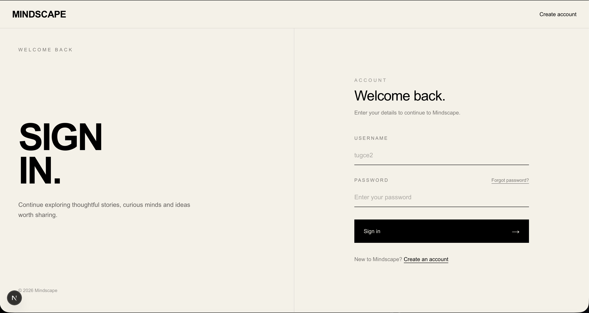
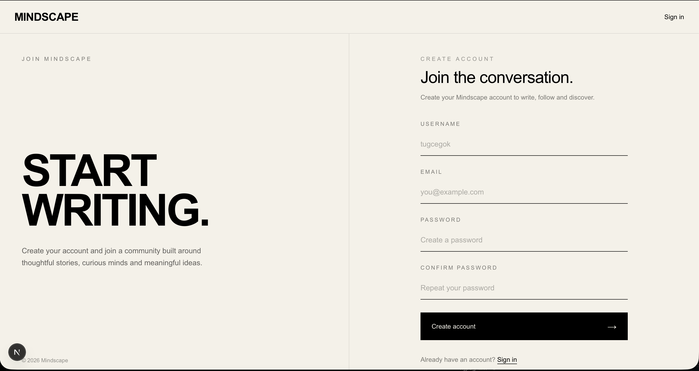

# Medium Blog Platform

A full-stack Medium-inspired blogging platform built with FastAPI and Next.js.

The platform provides a complete blogging environment where users can create accounts, publish and manage articles, interact with other writers, follow users, comment on posts, and manage their profiles.

## Features

### Authentication & User Management
- User registration and login
- JWT-based authentication
- Password change and password reset
- Email verification
- User profile management
- Profile and cover images
- Bio and social links
- Username management
- Account deactivation

### Blog Posts
- Create, edit and delete posts
- Draft and publish workflow
- Scheduled publishing
- Unpublish and archive posts
- Duplicate posts
- Post preview
- Reading time calculation
- Version history

### Editor
- Markdown support
- Rich text editing
- Code blocks
- Syntax highlighting
- Image, video and file support
- Tables and quotes
- Table of contents

### Social Features
- Comments
- Claps
- Likes and reactions
- Follow / unfollow users
- Reposts
- Favorites
- Collections
- Notifications

### Discovery
- Search
- Categories
- Tags
- Writer profiles
- Dashboard

### Administration
- Admin dashboard
- User management
- Post management
- Comment management

## Tech Stack

### Backend
- Python
- FastAPI
- SQLAlchemy
- SQLite
- Pydantic
- JWT Authentication
- Passlib / bcrypt
- Uvicorn

### Frontend
- Next.js 16
- React 19
- TypeScript
- Tailwind CSS 4
- GSAP

## Project Structure

```text
medium-blog-platform/
├── backend/
│   ├── app/
│   │   ├── models/
│   │   ├── routers/
│   │   ├── schemas/
│   │   ├── services/
│   │   └── utils/
│   ├── requirements.txt
│   └── test_email.py
│
├── frontend/
│   ├── app/
│   ├── lib/
│   ├── public/
│   ├── package.json
│   └── next.config.ts
│
└── README.md
```

## Getting Started

### Backend

Navigate to the backend directory:

```bash
cd backend
```

Create and activate a virtual environment:

```bash
python3 -m venv venv
source venv/bin/activate
```

Install the dependencies:

```bash
pip install -r requirements.txt
```

Configure the required environment variables in a `.env` file.

Start the FastAPI development server:

```bash
uvicorn app.main:app --reload
```

The backend will normally be available at:

```text
http://127.0.0.1:8000
```

FastAPI interactive API documentation:

```text
http://127.0.0.1:8000/docs
```

### Frontend

Open another terminal and navigate to the frontend directory:

```bash
cd frontend
```

Install the dependencies:

```bash
npm install
```

Start the development server:

```bash
npm run dev
```

The frontend will normally be available at:

```text
http://localhost:3000
```

## Security

Environment variables, local databases, virtual environments, uploaded files, Node.js dependencies and build artifacts are excluded from version control.

Sensitive configuration values should be stored in local environment files and should never be committed to the repository.

## Purpose

This project was developed as a full-stack web application to practice and demonstrate backend API development, authentication, database management, RESTful architecture, frontend development and backend-frontend integration.

## Author

**Tuğçe Gök**


---

## Screenshots

### Home Page


### Login Page


### Register Page
